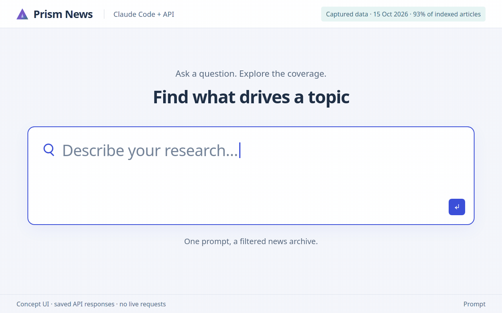
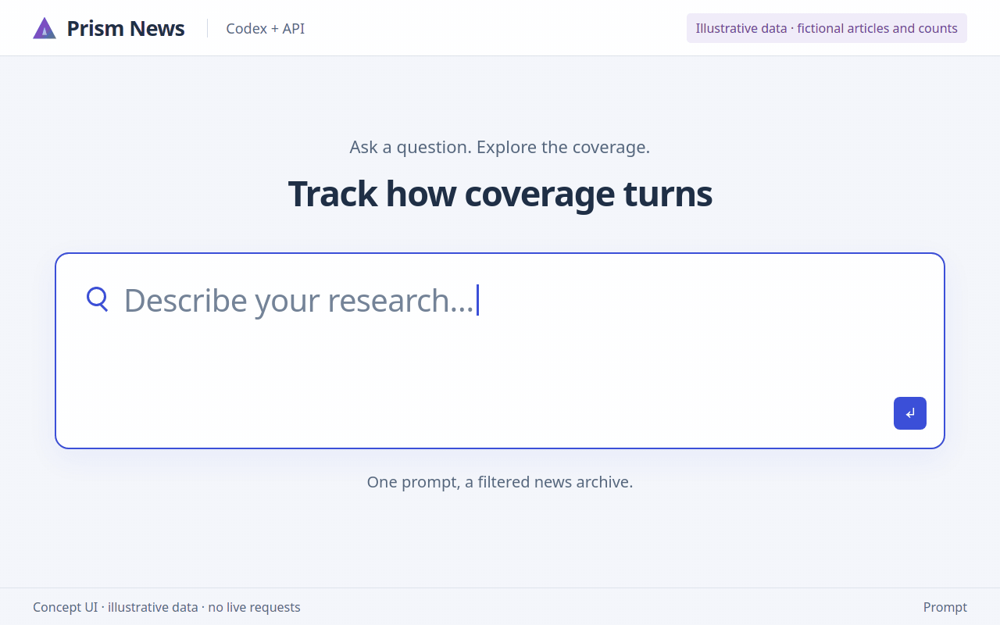
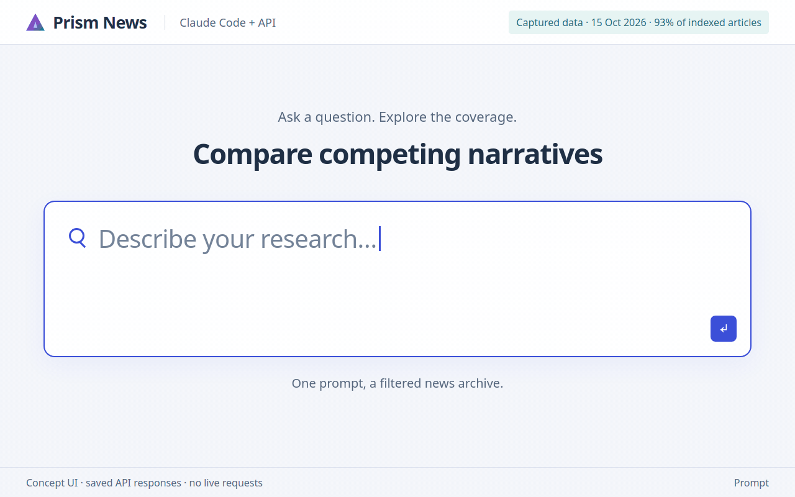
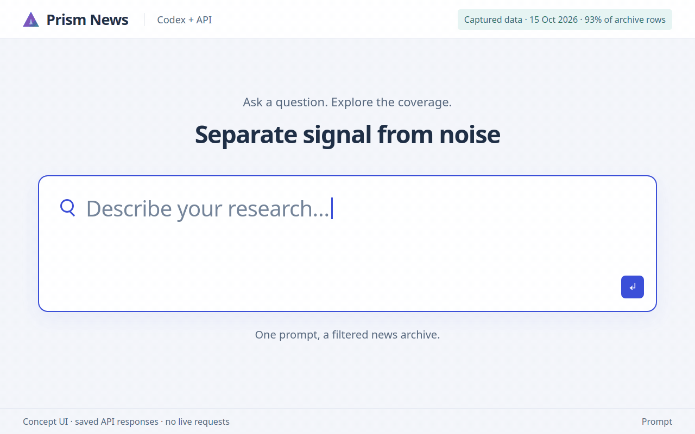
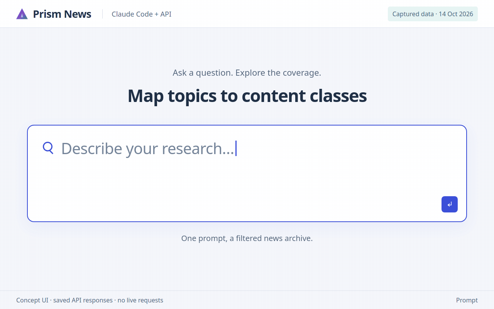
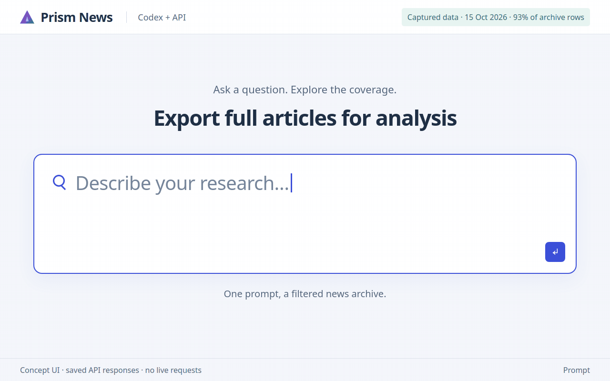

# Prism News API

[](https://pypi.org/project/prism-news/)
[](https://pypi.org/project/prism-news/)

Explore **450M+ historical and real-time news articles** from Fliar. Search news, combine sentiment, priority and GCP content codes, discover themes, compare subjects, and retrieve headlines or full articles.

**Live.** Base URL `https://radar-api.fliarbi.com/news` (business endpoints: `https://radar-api.fliarbi.com/business-news`). Create your own key in the Fliar dashboard; one key works on the Radar API and both News APIs. Free tier included; see [plans and prices](#plans-and-prices). While part of the news index is offline, answers say so in `meta.notes` and their counts are lower bounds.

<!-- scenarios:start -->
## 300 worked demonstrations

Real questions, real responses: each page answers one researched search query with
saved live API output: volume, tone, a twelve-month series, countries, themes and
critical headlines, plus the exact CLI, curl and Python calls.
[Browse all 300](docs/scenarios/README.md) or start with a segment:

| Segment | Pages | Start with |
| --- | ---: | --- |
| **[Industry research](docs/scenarios/industry-research/README.md)** | 50 | [Automotive](docs/scenarios/industry-research/automotive-industry.md) · [Textile](docs/scenarios/industry-research/textile-industry.md) · [Food Processing](docs/scenarios/industry-research/food-processing-industry.md) · [Pharmaceutical](docs/scenarios/industry-research/pharmaceutical-industry.md) |
| **[Financial research](docs/scenarios/financial-research/README.md)** | 50 | [Stock Market](docs/scenarios/financial-research/stock-market-news.md) · [Crypto](docs/scenarios/financial-research/crypto-news.md) · [GST](docs/scenarios/financial-research/gst-news.md) · [Gold Price](docs/scenarios/financial-research/gold-price-news.md) |
| **[Disease and health research](docs/scenarios/disease-health/README.md)** | 50 | [Measles](docs/scenarios/disease-health/measles-outbreak.md) · [Ebola](docs/scenarios/disease-health/ebola-outbreak.md) · [Influenza](docs/scenarios/disease-health/influenza-outbreak.md) · [COVID](docs/scenarios/disease-health/covid-news.md) |
| **[Policy and regulation research](docs/scenarios/policy-regulation/README.md)** | 50 | [Supreme Court](docs/scenarios/policy-regulation/supreme-court-news.md) · [Tariffs](docs/scenarios/policy-regulation/tariffs-news.md) · [AI Regulation](docs/scenarios/policy-regulation/ai-regulation-news.md) · [Food Safety](docs/scenarios/policy-regulation/food-safety-news.md) |
| **[Technology and AI research](docs/scenarios/technology-ai/README.md)** | 50 | [Artificial Intelligence](docs/scenarios/technology-ai/artificial-intelligence-news.md) · [Tiktok](docs/scenarios/technology-ai/tiktok-news.md) · [Spacex](docs/scenarios/technology-ai/spacex-news.md) · [Cybersecurity](docs/scenarios/technology-ai/cybersecurity-news.md) |
| **[Energy and climate research](docs/scenarios/energy-climate/README.md)** | 50 | [Natural Gas](docs/scenarios/energy-climate/natural-gas-news.md) · [Petrol Price](docs/scenarios/energy-climate/petrol-price-news.md) · [Coal](docs/scenarios/energy-climate/coal-industry.md) · [Cyclone](docs/scenarios/energy-climate/cyclone-news.md) |

Topics come from [keyword research](docs/research/KEYWORD_RESEARCH.md) (India and US monthly searches).
Captured with 1 of 14 news-index shards offline, so counts are lower bounds.
<!-- scenarios:end -->

<!-- demos:start -->
## See the API in a research UI

[6 animated Claude Code / Codex workflow concepts](docs/ANIMATED_USE_CASES.md) show
what an assistant can build on this API. They cover theme discovery, a weekly sentiment shift, comparing two topics, critical alerts, GCP content-class codes and full-article export. Each GIF labels saved API
responses or illustrative data; these are client-built UI concepts, not recordings of
official client interfaces or claims of live service availability. Open the
[interactive gallery](docs/demos/index.html) locally for prompts and request recipes.

<table>
  <tr>
    <td width="50%" valign="top">
      <h3>EV theme discovery</h3>
      <a href="docs/demos/media/ev-theme-discovery.gif"></a>
      <p>Ask a broad topic, get ranked themes, then open the coverage behind the strongest one. Saved API responses.</p>
    </td>
    <td width="50%" valign="top">
      <h3>Tariff sentiment shift</h3>
      <a href="docs/demos/media/tariff-sentiment.gif"></a>
      <p>See when a story turned, how far it moved from the all-news norm, and which headlines drove it. Saved API responses.</p>
    </td>
  </tr>
  <tr>
    <td width="50%" valign="top">
      <h3>Compare two topics</h3>
      <a href="docs/demos/media/ai-topic-compare.gif"></a>
      <p>Put two narratives on one scale, with exact overlap and per-topic criticality. Saved API responses.</p>
    </td>
    <td width="50%" valign="top">
      <h3>Critical news alerts</h3>
      <a href="docs/demos/media/critical-alerts.gif"></a>
      <p>Quantify how much of a topic is urgent, then read just those stories. Saved API responses.</p>
    </td>
  </tr>
  <tr>
    <td width="50%" valign="top">
      <h3>GCP class code map</h3>
      <a href="docs/demos/media/class-code-map.gif"></a>
      <p>Find the right content-class codes by name, then filter any endpoint by them. Saved API responses.</p>
    </td>
    <td width="50%" valign="top">
      <h3>Full articles to CSV</h3>
      <a href="docs/demos/media/full-article-export.gif"></a>
      <p>Move from a filter to full article text in a file your analysis tools can read. Saved API responses.</p>
    </td>
  </tr>
</table>
<!-- demos:end -->

## Install in one line

Requires Bash, curl and Python 3.8+. The installer adds `prism-news` and
`prism-business-news` (one client for both APIs) to `~/.local/bin` and sets
`PRISM_API_BASE` and `PRISM_BUSINESS_API_BASE` for every new shell, so curl, Python
and the CLI work without configuring a URL. It never uses sudo or starts services.

```bash
curl -fsSL https://raw.githubusercontent.com/fliarbi/prism-news-api/main/scripts/install.sh | bash
```

See [Getting started](docs/GETTING_STARTED.md) for options, every command and troubleshooting.

### Python package (pip)

```bash
pip install prism-news
```

The [`prism-news`](https://pypi.org/project/prism-news/) package (standard library only, Python 3.8+)
installs the same `prism-news` and `prism-business-news` commands, a `Client` class, and loaders
for 60 open news-topic datasets (January 2019 to July 2026):

```python
from prism_news import Client, datasets

client = Client()                                   # key from PRISM_API_KEY
client.headlines("electric vehicle", since="2026-01-01", limit=10)

datasets.list_topics()                              # no key needed
tables = datasets.load("floods")                    # sample, monthly, countries
```

Source, tests and examples: [packages/python](packages/python/README.md).

### JavaScript / TypeScript client

A zero-dependency ESM client with TypeScript types and a small CLI lives in
[packages/npm](packages/npm/README.md). The npm registry release is pending; until then use it
from a checkout:

```bash
git clone https://github.com/fliarbi/prism-news-api && cd prism-news-api/packages/npm && npm link
prism-news --help
```

## Get started in five steps

| Step | Do this | You get |
|---:|---|---|
| 1 | [Fliar dashboard](https://fliarbi.com/radar/dashboard?tab=radarapi) → **API keys** → **Create or manage API keys** → create a key with **All data** or **News only** access | One `rdr_` key for both News APIs and the Radar API |
| 2 | Run the one-line installer above | The `prism-news` and `prism-business-news` commands |
| 3 | `prism-news login` | Base URLs and key saved owner-only in `~/.config/prism/config.json` |
| 4 | `prism-news status`, then `prism-news me` | Data dates, your plan, limits and this month's usage |
| 5 | Open a [demonstration](docs/scenarios/README.md), copy its commands and change the subject | Your own version of a worked example |

| Task | Command | Endpoint |
|---|---|---|
| Subject overview | `prism-news overview "steel industry" --since 2026-01-01 --until 2026-04-30` | `POST /v1/overview` |
| Monthly volume | `prism-news trends "inflation" --granularity monthly --table` | `POST /v1/trends` |
| Tone | `prism-news sentiment "tariffs" --granularity weekly` | `POST /v1/sentiment` |
| Where it was reported | `prism-news geography "dengue" --table` | `POST /v1/geography` |
| Themes | `prism-news themes "electric vehicle" --table` | `POST /v1/themes` |
| Critical headlines | `prism-news headlines "semiconductor" --priority-min 7 --sort priority --table` | `POST /v1/headlines` |
| Compare subjects | `prism-news compare --json '{"queries": [{"name": "A", "filters": {"q": "AI regulation"}}, {"name": "B", "filters": {"q": "AI investment"}}]}'` | `POST /v1/compare` |
| Full text to a file | `prism-news export "battery storage" --limit 50 -o battery.csv` | `POST /v1/export` |
| Any endpoint | `prism-news call POST /v1/coverage '{"q": "monsoon"}'` | any |

## Plans and prices

| Plan | Price | Requests / month | Full-text exports / month | Requests / min | At once | Headlines per call | History |
|---|---|---:|---:|---:|---:|---:|---|
| Free | ₹0 | 1,000 | 100 | 30 | 2 | 100 | Last 365 days |
| **Pay as you go** | **₹0.84 / US$0.01 per credit** | 1 credit each | 1 credit each | by level | by level | your plan's | your plan's |
| Pro | ₹4,000 (US$49) / month | 25,000 | 2,500 | 120 | 5 | 100 | Full history |
| Business | ₹15,000 (US$180) / month | 150,000 | 15,000 | 600 | 10 | 500 | Full history |
| Enterprise | Custom | 2,000,000 | 200,000 | 3,000 | 25 | 1,000 | Full history |

Prices exclude GST. One plan covers both the Prism News API and the Prism Business News API.

**Pay as you go** needs no subscription. Buy prepaid credits (minimum 500 credits, US$5)
on the [API key page](https://fliarbi.com/radar-api/developer); one credit pays for one
request or one full-text article. On Free it starts after the free allowance; on a paid
plan, after the plan's monthly allowance, so nothing stops when you run out. The same
wallet pays for Radar API calls. You set a monthly spending limit, failed requests are
refunded, and a response paid with credits says so in `meta.notes`.

**Usage levels.** The more credits an account has used in total (Radar and Prism News
together), the higher its limits. Levels apply automatically and never go down; from
Growth up, your limits are the higher of your plan's and your level's.

| Level | Credits used (lifetime) | Requests / min | Requests at once | Prepaid credits / day |
|---|---:|---:|---:|---:|
| Starter | 0 | plan | plan | 5,000 |
| Growth | 10,000 | 120 | 5 | 25,000 |
| Scale | 100,000 | 300 | 10 | 100,000 |
| Premier | 1,000,000 | 600 | 20 | 500,000 |

Upgrade or buy credits in the [Fliar dashboard](https://fliarbi.com/radar/dashboard?ws=marketai&tab=radarapi)
under **API keys**; Enterprise is by arrangement with Fliar. `/v1/me` shows your plan,
level and effective limits.

## Make a first request with curl or Python

1. Sign in to the [Fliar dashboard](https://fliarbi.com/radar/dashboard?tab=radarapi), open **API keys** (in the Radar or the Fliar Prism workspace) and choose **Create or manage API keys**. On the key page, choose **Connect Radar session**, pick **All data** or **News only** access and create a key. It starts with `rdr_` and also works on the Radar API.
2. The installer sets `PRISM_API_BASE`; without it, `export PRISM_API_BASE=https://radar-api.fliarbi.com/news`. Set `PRISM_API_KEY` to your key and keep it private.
3. Check your access, then search:

```bash
curl -sS "$PRISM_API_BASE/v1/me" -H "X-API-Key: $PRISM_API_KEY"

curl -sS --get "$PRISM_API_BASE/v1/headlines" \
  -H "X-API-Key: $PRISM_API_KEY" \
  --data-urlencode 'q=electric vehicle' \
  --data-urlencode 'sentiment=negative' \
  --data-urlencode 'priority_min=7' \
  --data-urlencode 'classes=0' \
  --data-urlencode 'limit=100'
```

GCP code `0` means `/News/Business News/Company News`. Filters combine, so a narrow request can return `404 no_data`. Start with `q` alone if needed. `Authorization: Bearer YOUR_API_KEY` is also accepted.

```python
import os
import requests

response = requests.get(
    os.environ.get("PRISM_API_BASE", "https://radar-api.fliarbi.com/news") + "/v1/headlines",
    headers={"X-API-Key": os.environ["PRISM_API_KEY"]},
    params={"q": "electric vehicle", "limit": 100},
    timeout=60,
)
payload = response.json()
if not response.ok or not payload.get("ok"):
    raise RuntimeError(f"HTTP {response.status_code}: {payload.get('error')}")
print(payload["window"], payload["meta"].get("notes", []))
for article in payload["data"]["items"]:
    print(article["headline"], article["url"])
```

## Choose a workflow

| Goal | Start here |
|---|---|
| Understand a subject | `/v1/overview`, then `/v1/headlines` |
| Discover themes | `/v1/themes` with required `q`; at most **5** results |
| Read a selected theme | `/v1/themes/{name}/headlines`; **100** per page by default |
| Compare subjects | `POST /v1/compare` with **2–5** named filter sets |
| Inspect tone, importance or volume | `/v1/sentiment`, `/v1/priority`, `/v1/trends` |
| Explore location and availability | `/v1/geography` with required `q` and at most **5** results; `/v1/coverage` |
| Retrieve full text | `/v1/articles/{article_id}` or `POST /v1/export`, **100** per batch by default |

Headline and export requests default to 100; higher limits depend on your plan. Check `/v1/me` for your caps.

Read the **[User guide](docs/USER_GUIDE.md)** for authentication, filters, theme drilldown, pagination, exports, comparisons, freshness, quotas, errors and the endpoint reference. The guide is also served as Markdown at `/guide` on your supplied API base. For company events and funding, see the [Business News API guide](https://github.com/fliarbi/prism-business-news-api/blob/main/docs/USER_GUIDE.md).

## Running the service

Copy `.env.example` to `.env` and fill in the deployment's addresses, credentials and table names. `.env` is never committed. Then:

```bash
pip install -r requirements.txt
./run.sh --bg        # gunicorn on :8800, logs under logs/
python3 -m pytest -q # offline tests, no data stores needed
```
